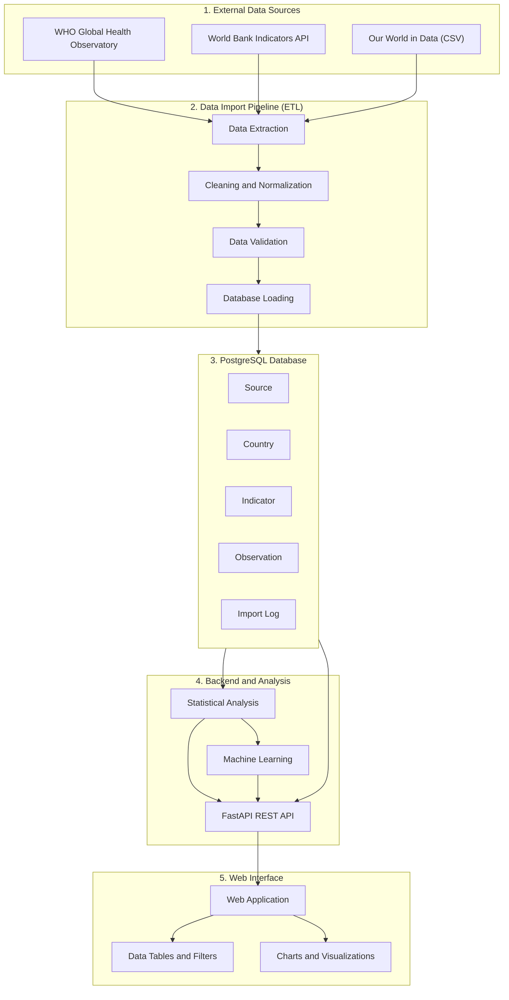

# Task 1.6 — Application Architecture and Project Structure

## 1. Application Architecture

The Global Health Data Platform follows a layered architecture. Its purpose is to collect, process, store, analyze, and present country-level diabetes and lifestyle risk-factor data.

### Architecture Diagram
Markdown Preview Mermaid Support required to see the diagram


### 2. Layer Responsibilities

**Layer 1 — External Data Sources**

The platform uses public data sources:

- WHO Global Health Observatory: diabetes prevalence and other health indicators.
- World Bank Indicators API: socioeconomic and development indicators.
- Our World in Data: downloadable datasets related to diabetes and lifestyle risk factors.

**Layer 2 — Data Import Pipeline (ETL)**

The ETL pipeline extracts data from external sources, cleans and normalizes country identifiers, validates records, and loads the processed data into PostgreSQL. Raw downloads are cached in `data/raw/` to support reproducibility.

**Layer 3 — PostgreSQL Database**

PostgreSQL provides centralized storage for the platform. Its tables include:

- `source`: information about data providers.
- `country`: country identifiers and metadata.
- `indicator`: indicator names, codes, units, and sources.
- `observation`: country-level indicator values by year.
- `import_log`: records of data import operations.

**Layer 4 — Backend and Analysis**

FastAPI provides REST endpoints for accessing stored data. The analysis layer performs statistical analysis, comparisons, and trend analysis. Machine learning components can use country-level indicators for clustering and diabetes prevalence estimation.

**Layer 5 — Web Interface**

The web interface allows users to explore diabetes prevalence, compare lifestyle risk factors across countries, filter observations, and view historical trends through tables and visualizations.

### 3. Why the Database Is Separated from External Sources

The PostgreSQL database is separated from external data sources to provide a centralized and reliable storage layer. Only the ETL pipeline communicates directly with external APIs and downloads CSV files. It processes and stores the data in PostgreSQL, while the backend API, statistical analysis, machine learning components, and web interface retrieve data from the database. This architecture reduces dependency on external API availability, avoids repeated downloads, improves application performance, and provides a consistent dataset for analysis. It also makes it easier to add new data sources without changing the application interface or analysis components.

## 4. Project Folder Structure

```text
CSPG/
├── .env
├── .gitignore
├── requirements.txt
├── docker-compose.yml
├── README.md
│
├── db/
│   └── schema.sql
│
├── data/
│   └── raw/
│       └── .gitkeep
│
├── etl/
│   ├── __init__.py
│   ├── extract_who.py
│   ├── extract_worldbank.py
│   ├── extract_owid.py
│   ├── clean.py
│   ├── load.py
│   └── run_import.py
│
├── app/
│   ├── __init__.py
│   ├── database.py
│   ├── models.py
│   ├── create_tables.py
│   ├── main.py
│   │
│   ├── templates/
│   │   ├── base.html
│   │   └── observations.html
│   │
│   └── docs/
│       ├── task_1_2_topic_proposal.md
│       ├── task_1_3_environment.md
│       ├── task_1_5_challenges.md
│       └── task_1_6_architecture.md
│
├── notebooks/
│   └── .gitkeep
│
└── tests/
    └── test_api.py
```

### 5. Main Directory Responsibilities

| Directory | Responsibility |
|---|---|
| `app/` | FastAPI backend, database integration, and web templates |
| `app/docs/` | Project and assignment documentation |
| `app/templates/` | HTML templates for the web interface |
| `etl/` | Data extraction, cleaning, normalization, and loading |
| `db/` | Database schema definitions |
| `data/raw/` | Cached original datasets and downloads |
| `notebooks/` | Exploratory data analysis and experiments |
| `tests/` | Automated application and API tests |

## 6. Conclusion

The proposed architecture separates data acquisition, storage, backend services, analysis, and presentation. This modular design supports the integration of multiple global health data sources and allows the platform to evolve as additional indicators and analytical features are introduced.